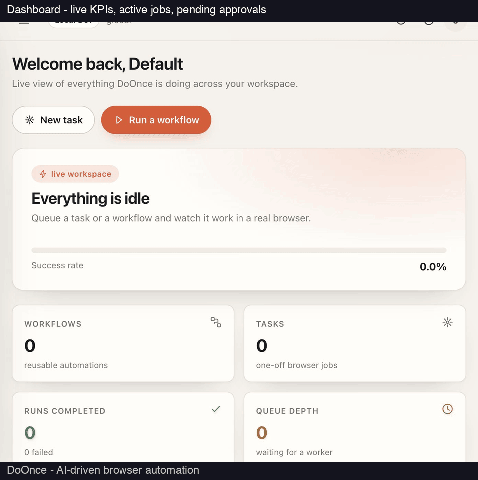

# DoOnce Enterprise

**AI-driven browser automation for regulated enterprises.**

DoOnce is a Rust full-stack platform for natural-language browser tasks and
deterministic, replayable workflows. It runs on-prem, air-gapped or as a
hybrid SaaS, with tenant isolation, RBAC, SSO and tamper-evident audit logs.

- Apache-2.0 licensed. AGPL-licensed projects are used only as a behavioral
  reference; no code is copied.


- Targets SOC 2 Type II, ISO 27001, GDPR, KVKK, HIPAA and PCI-DSS. Cardholder
  data is never stored; PHI requires an isolated data plane.

---

## Table of contents

1. [Repository layout](#repository-layout)
2. [Quick start](#quick-start)
3. [Configuration](#configuration)
4. [Features](#features)
5. [Usage examples](#usage-examples)
6. [Deployment modes](#deployment-modes)
7. [SDKs, MCP and integrations](#sdks-mcp-and-integrations)
8. [Development](#development)
9. [Compliance and roadmap](#compliance-and-roadmap)
10. [Türkçe](#türkçe)

---

## Open Core & Enterprise

DoOnce follows an **open core** model:

- **`DoOnce` (this repo, public, Apache-2.0):** core engine, browser automation,
  security primitives, storage, LLM clients, deterministic replay, task agent,
  CLI, basic web console, SDKs.
- **`doonce-enterprise` (private, proprietary):** SSO (OIDC/SAML), SCIM, MFA
  (TOTP/WebAuthn), multi-tenant orchestration, advanced audit, hybrid connector,
  compliance automation, advanced RBAC, enterprise settings/admin UI.

The enterprise crate depends on the open core and adds proprietary modules.
Core works standalone (API-key auth + basic RBAC); enterprise features require
the enterprise edition.

## Repository layout

```
crates/
  doonce-core/        Domain model, workflow v2 blocks, validation, risk, templates
  doonce-security/    AES-256-GCM, API keys, RBAC, redaction, audit hash chain
  doonce-store/       SQLite/Postgres persistence, migrations, repositories
  doonce-browser/     CDP client, Chrome launcher, isolated page agent
  doonce-engine/      Deterministic browserAction/wait replay executor
  doonce-llm/         OpenAI/Anthropic/Gemini/Ollama/compatible clients + vision
  doonce-agent/       Natural-language task loop (act/extract/validate/prompt)
  doonce-services/    AI, credential providers, SMTP, artifacts, workflow resolver
  doonce-server/      Axum REST API, auth, RBAC, OpenAPI, console host
  doonce-worker/      Queue/lease worker, scheduler, approvals, webhooks
  doonce-cli/         `doonce` bootstrap, diagnostics, replay, agent, serve, worker
web/                  React/Vite console
docs/                 ADRs, threat model, security and compliance notes
compliance/           Control matrix and audit evidence plan
deploy/               Docker/Helm/systemd, air-gap bundle, runbooks
sdk/python/           Dependency-free Python SDK
sdk/typescript/       Dependency-free TypeScript SDK
examples/             Sample workflows and integration recipes
```

## Quick start

```bash
cargo build --release
./target/release/doonce quickstart
./target/release/doonce doctor
./target/release/doonce config list
```

`quickstart` creates a data directory, a 32-byte master key (`master.key`, mode
`0600`), a SQLite database (`doonce.db`), the `default` tenant, an owner
identity and the first API key. The API key is printed **once** — store it.

```bash
./target/release/doonce serve          # http://127.0.0.1:8080
./target/release/doonce worker --concurrency 2
```

For production use Postgres (`DOONCE_DATABASE_URL`) and a KMS/HSM-backed master
key (`DOONCE_MASTER_KEY`).

## Configuration

| Variable | Purpose |
|---|---|
| `DOONCE_HOME` | Data directory override |
| `DOONCE_DATABASE_URL` | `postgres://...` or `sqlite://...?mode=rwc` |
| `DOONCE_MASTER_KEY` | Base64 32-byte key from KMS/HSM/secret manager |
| `DOONCE_ENV` | `production` requires Postgres, KMS key, HTTPS, secure cookies |
| `DOONCE_PUBLIC_URL` | External base URL for OIDC redirects/cookies |
| `DOONCE_COOKIE_SECURE` | Force secure session cookies |
| `DOONCE_SESSION_TTL_SECS` | Browser session lifetime (default 28800) |
| `DOONCE_LOG` | Tracing filter (default `info`) |
| `DOONCE_TELEMETRY` | `false` disables telemetry (default) |
| `DOONCE_ARTIFACT_DIR` | Screenshot/artifact root (default `$DOONCE_HOME/artifacts`) |
| `DOONCE_HEADLESS` | `false` for visible Chrome (anti-bot / 2FA sites) |
| `DOONCE_CHROME_PROFILE` | Persistent Chrome profile (forces concurrency 1) |
| `DOONCE_CDP_URL` | Attach to an existing Chrome instead of launching one |
| `DOONCE_PROXY` / `DOONCE_USER_AGENT` | Egress/user-agent overrides |
| `DOONCE_DEPLOYMENT_MODE` | `saas`, `onprem` or `airgapped` (default `onprem`) |
| `DOONCE_REGION` | Tenant/connector residency region (default `global`) |
| `DOONCE_LLM_PROVIDER` / `_MODEL` / `_BASE_URL` / `_API_KEY` | AI provider (key from env only) |
| `DOONCE_SMTP_URL` / `DOONCE_EMAIL_FROM` | Outbound email |
| `DOONCE_CONTROL_URL` / `DOONCE_CONNECTOR_TOKEN` | Hybrid connector settings |

Full list: `.env.example`.

## Features

### Security and identity
- API-key auth (`x-api-key` / `Authorization: Bearer`), Argon2 verification, RBAC,
  tenant scoping on every query.
- OIDC SSO (authorization code + PKCE, discovery, ID-token validation, JIT
  provisioning), browser sessions with HttpOnly/SameSite=Strict cookies, CSRF
  double-submit, server-side revocation.
- TOTP MFA enrollment/verification; sessions gated until verified.
- SCIM 2.0 user provisioning at `/scim/v2/Users`.
- AES-256-GCM envelope encryption, SHA-256 audit hash chain, SSRF guards,
  secret redaction.

### Workflow engine
- Block types: `browserTask`, `browserAction`, `extract`, `validate`, `forLoop`,
  `conditional`, `httpRequest`, `code`, `fileParse`, `sendEmail`, `textPrompt`,
  `upload`, `downloadFiles`, `login`, `humanApproval`, `runWorkflow`, `wait`,
  `terminate`, `goto`.
- Top-level `prompt` becomes an implicit first `browserTask` block.
- Deterministic replay with retries, timeouts, cancellation, risk approvals.
- Visual builder in the console (palette, reorder, JSON inspector, validate/save).
- Variables: `{{block.output.field}}` and `saveAs`, validated at import time.

### Browser layer
- CDP client, Chrome launcher, isolated-world page agent with multi-signal
  locator scoring (role, name, label, text, attributes, selectors, context).
- Actions: click, hover, fill, select, check, press, navigate, switch tab,
  download, extract. Conditions: URL/text/visible/hidden.
- Screenshot capture, `browser observe` JSON, live view via `browser stream`.

### AI and natural-language tasks
- Providers: OpenAI, Anthropic, Gemini, Ollama, OpenAI-compatible (incl.
  OpenRouter, DeepSeek). Vision when supported; `--no-vision` to disable.
- Agent loop: observe → one action → execute → repeat, with history, error codes,
  step/time budgets, cancellation.
- Page commands: `act`, `extract` (JSON Schema validated), `validate`, `prompt`.

### Credentials
- Local encrypted vault (AES-256-GCM) plus external references: Bitwarden,
  1Password, LastPass, custom HTTP service. Secrets fetched at run time, never
  persisted. TOTP from provider secret or vault.

### Worker, scheduler, webhooks
- Database-leased queue, cron schedules per timezone, human approval gates.
- Signed webhooks (`x-doonce-signature: sha256=...`) with retries and delivery log.
- Final-state screenshots and artifact storage (tenant-scoped, path-canonicalized,
  50 MB limit).

### Console (web UI)
- React/Vite app: dashboard, tasks, workflows, runs, schedules, approvals,
  connectors, credentials, audit, settings. Light/dark theme, responsive, drawer
  dialogs, toast notifications.

### Hybrid / on-prem / air-gapped
- `DOONCE_DEPLOYMENT_MODE=saas|onprem|airgapped`. Air-gapped refuses telemetry
  and dev-no-auth, requires a loopback LLM endpoint.
- Outbound-only connector: control plane queues jobs, connector leases and runs
  them locally; screenshots/profiles/credentials stay in the data plane.

## Usage examples

### Natural-language task (CLI)
```bash
export DOONCE_LLM_PROVIDER=openai
export DOONCE_LLM_API_KEY=...
doonce task run "Find the top post title and points" \
  --url https://news.ycombinator.com --headless
```

### Page commands
```bash
doonce page act "Click the search button" --url https://www.google.com --headless
doonce page extract "Get the title and points" --schema schema.json --url https://news.ycombinator.com --headless
doonce page validate "Are search results visible?" --url https://www.google.com --headless
doonce page prompt "Summarize this page" --url https://www.google.com --headless
```

### Prompt workflow (JSON)
```json
{
  "schemaVersion": "2.0",
  "name": "Google search digest",
  "prompt": "Go to Google, search for \"best rust web framework\" and return the top 3 results with title, url and snippet.",
  "url": "https://www.google.com",
  "maxSteps": 20,
  "blocks": []
}
```

### Deterministic replay
```bash
doonce workflow validate examples/workflows/google-search.json
doonce workflow show examples/workflows/google-search.json
doonce replay examples/workflows/google-search.json --headless
```

### Inspect a page
```bash
doonce browser check --url https://www.google.com --headless
doonce browser observe --url https://www.google.com --headless
doonce browser screenshot --url https://www.google.com --headless -o page.png
doonce browser stream --url https://www.google.com --port 8099
```

### Console + API
```bash
doonce quickstart
doonce serve                       # http://127.0.0.1:8080
curl -H "x-api-key: dsk_..." http://127.0.0.1:8080/api/v1/auth/me
curl http://127.0.0.1:8080/api/v1/openapi.json
```

### Worker and scheduler
```bash
doonce serve
doonce worker --concurrency 2
# or: doonce worker --auto-approve   (trusted automation only)
```

## Deployment modes

- **SaaS**: control plane and worker together; simplest.
- **On-prem**: everything in the customer's environment.
- **Air-gapped**: no telemetry, no dev-no-auth, loopback LLM endpoint required.
- **Hybrid**: control plane in cloud, connector (worker) in customer VPC. Jobs
  are leased outbound; screenshots/profiles/credentials stay in the data plane.
  Create a connector in the console, copy the one-time token, then:
  ```bash
  DOONCE_CONTROL_URL=https://doonce.example.com \
  DOONCE_CONNECTOR_TOKEN=dsk_... \
  DOONCE_CONNECTOR_LOCAL_URL=http://127.0.0.1:8080 \
  doonce connector --auto-approve
  ```

Assets: `docker-compose.yml`, `Dockerfile`, `deploy/helm/doonce`,
systemd units, `deploy/scripts/build-airgap-bundle.sh`.

## SDKs, MCP and integrations

```bash
# Python SDK (no runtime dependencies)
pip install -e sdk/python
python3 -m unittest discover -s sdk/python/tests

# TypeScript SDK
cd sdk/typescript && npm install && npm run build && npm test

# MCP stdio server for Claude Desktop / Cursor
DOONCE_API_KEY=dsk_... doonce mcp --url http://127.0.0.1:8080 --read-only
```

See `sdk/python/README.md`, `sdk/typescript/README.md` and
`docs/integrations/README.md` (including the importable n8n workflow).

## Development

```bash
cargo fmt --all -- --check
cargo clippy --workspace --all-targets -- -D warnings
cargo test --workspace
cargo deny check
```

Web console:
```bash
cd web && npm install && npm run build
```

See `CONTRIBUTING.md`, `SECURITY.md`, `docs/security/threat-model.md` and
`compliance/control-matrix.md`.

## Compliance and roadmap

| Phase | Deliverable | Status |
|---|---|---|
| 1 | Domain, workflow schema, store, security, CLI | done |
| 2 | CDP browser layer, page agent, deterministic replay | done |
| 3 | LLM providers, vision, task agent | done |
| 4 | REST API, API-key/RBAC, OpenAPI, web console | done |
| 4b | OIDC SSO, sessions/CSRF, TOTP MFA, SCIM | done |
| 5a | Block engine (loop/conditional/HTTP/code/file) + builder | done |
| 5b | AI/email/upload/login/downloadFiles/nested workflows | done |
| 6 | Bitwarden/1Password/LastPass/custom HTTP credentials | done |
| 7 | Worker/queue, scheduler, approvals, HMAC webhooks | done |
| 8 | Screenshot artifacts, live view, metrics/SLO | done |
| 9 | Python/TS SDKs, MCP, Zapier/Make/n8n recipes | done |
| 10 | Hybrid connector, on-prem/air-gapped, residency | done |
| 11 | Pen-test, DR drills, audit evidence automation | external gate (skipped by request) |
| 12 | GA readiness: release CI, SBOM/signing, prod guardrails | done (audits external) |

Release: `.github/workflows/release.yml` builds Linux/macOS/Windows binaries,
checksums, source SBOM, GHCR image with provenance and cosign keyless signature.
`scripts/compliance/export-evidence.sh` exports commit/tool/migration hashes and
an optional CycloneDX SBOM. `docs/GA-CHECKLIST.md` separates code-complete
controls from external audits.

---

<a id="türkçe"></a>

## Türkçe

**Kurumsal düzenlenmiş ortamlar için AI destekli tarayıcı otomasyonu.**

DoOnce; doğal dilde tarayıcı görevleri ve deterministik, yeniden oynatılabilir
iş akışları için Rust ile yazılmış full-stack bir platformdur. Çok kiracılı SaaS,
on-prem veya hava boşluklu (air-gapped) veri düzlemlerinde çalışır; kiracı
izolasyonu, RBAC, SSO ve değiştirilemez denetim (audit) günlükleri içerir.

- Apache-2.0 lisanslı. AGPL lisanslı projeler yalnızca davranış/özellik referansı
  olarak kullanılır; kod kopyalanmaz.


- SOC 2 Type II, ISO 27001, GDPR, KVKK, HIPAA ve PCI-DSS hedeflenir. Kart
  verisi asla saklanmaz; PHI için izole veri düzlemi gerekir.

### Açık Çekirdek ve Kurumsal

DoOnce **açık çekirdek** (open core) modelini izler:

- **`DoOnce` (bu repo, public, Apache-2.0):** çekirdek motor, tarayıcı otomasyonu,
  güvenlik temelleri, depolama, LLM istemcileri, deterministik replay, görev ajanı,
  CLI, temel web konsolu, SDK'lar.
- **`doonce-enterprise` (private, proprietary):** SSO (OIDC/SAML), SCIM, MFA
  (TOTP/WebAuthn), çok kiracılı orkestrasyon, gelişmiş denetim, hybrid connector,
  uyumluluk otomasyonu, gelişmiş RBAC, kurumsal ayarlar/admin UI.

Kurumsal crate, açık çekirdeğe bağımlıdır ve proprietary modüller ekler.
Çekirdek tek başına çalışır (API-key auth + temel RBAC); kurumsal özellikler
kurumsal sürüm gerektirir.

### Depo yapısı

`crates/` altında domain modeli, iş akışı v2 blokları, doğrulama, risk,
şablonlar, güvenlik (AES-256-GCM, API anahtarları, RBAC, denetim hash zinciri),
SQLite/Postgres kalıcılık, CDP tarayıcı katmanı, deterministik replay motoru,
LLM istemcileri (vision dahil), doğal dil görev döngüsü, servisler, Axum REST
API, kuyruk/lease worker, zamanlayıcı, onay akışı, webhook'lar ve CLI bulunur.
`web/` React/Vite konsolu, `docs/` ADR ve tehdit modeli, `deploy/` Docker/Helm/
systemd ve air-gap paketleri, `sdk/` Python/TypeScript SDK'ları içerir.

### Hızlı başlangıç

```bash
cargo build --release
./target/release/doonce quickstart
./target/release/doonce doctor
./target/release/doonce config list
```

`quickstart` veri dizini, 32 baytlık master key (`master.key`, mod `0600`),
SQLite veritabanı (`doonce.db`), `default` tenant'ı, sahip kimliği ve ilk API
anahtarını oluşturur. API anahtarı **bir kez** yazdırılır — güvenli bir yere
kaydedin.

```bash
./target/release/doonce serve          # http://127.0.0.1:8080
./target/release/doonce worker --concurrency 2
```

Üretimde Postgres (`DOONCE_DATABASE_URL`) ve KMS/HSM tabanlı master key
(`DOONCE_MASTER_KEY`) kullanın.

### Yapılandırma

Temel değişkenler: `DOONCE_HOME`, `DOONCE_DATABASE_URL`, `DOONCE_MASTER_KEY`,
`DOONCE_ENV`, `DOONCE_PUBLIC_URL`, `DOONCE_COOKIE_SECURE`,
`DOONCE_SESSION_TTL_SECS`, `DOONCE_LOG`, `DOONCE_TELEMETRY`,
`DOONCE_ARTIFACT_DIR`, `DOONCE_HEADLESS`, `DOONCE_CHROME_PROFILE`,
`DOONCE_CDP_URL`, `DOONCE_PROXY`/`DOONCE_USER_AGENT`,
`DOONCE_DEPLOYMENT_MODE`, `DOONCE_REGION`, `DOONCE_LLM_*`,
`DOONCE_SMTP_URL`/`DOONCE_EMAIL_FROM`, `DOONCE_CONTROL_URL`/
`DOONCE_CONNECTOR_TOKEN`. Tam liste: `.env.example`.

### Özellikler

**Güvenlik ve kimlik:** API-key doğrulaması, Argon2, RBAC, kiracı izolasyonu;
OIDC SSO (PKCE), HttpOnly/SameSite=Strict oturum cookie'leri, CSRF, sunucu
tarafı iptal; TOTP MFA; SCIM 2.0; AES-256-GCM zarf şifreleme; SHA-256 denetim
hash zinciri; SSRF korumaları; secret redaksiyonu.

**İş akışı motoru:** `browserTask`, `browserAction`, `extract`, `validate`,
`forLoop`, `conditional`, `httpRequest`, `code`, `fileParse`, `sendEmail`,
`textPrompt`, `upload`, `downloadFiles`, `login`, `humanApproval`,
`runWorkflow`, `wait`, `terminate`, `goto` blok tipleri. Üst düzey `prompt`
ilk `browserTask` bloğuna dönüşür. Yeniden deneme, zaman aşımı, iptal, risk
onayı ile deterministik replay. Konsolda görsel builder.

**Tarayıcı katmanı:** CDP istemcisi, Chrome başlatıcı, izole dünya sayfa
ajanı (çok sinyalli konumlandırma: role, name, label, text, attribute,
selector, context). Tıklama, hover, doldurma, seçim, onay, tuş, gezinme,
sekme değiştirme, indirme, çıkarma. Koşullar: URL/metin/görünür/gizli.
Screenshot, `browser observe` JSON, `browser stream` ile canlı görüntü.

**AI ve doğal dil görevleri:** OpenAI, Anthropic, Gemini, Ollama ve
OpenAI-uyumlu uç noktalar (vision destekli); `--no-vision` ile kapatılabilir.
Ajan döngüsü: gözlem → tek eylem → çalıştır → tekrar; geçmiş, hata kodları,
adım/zaman bütçesi, iptal. Sayfa komutları: `act`, `extract` (JSON Schema
doğrulamalı), `validate`, `prompt`.

**Kimlik bilgileri:** Yerel şifreli vault (AES-256-GCM) + harici referanslar:
Bitwarden, 1Password, LastPass, özel HTTP servisi. Secret'lar çalışma anında
alınır, asla kalıcı saklanmaz. TOTP, sağlayıcı secret'ından veya vault'tan.

**Worker, zamanlayıcı, webhook:** Veritabanı lease tabanlı kuyruk, saat dilimine
göre cron, insan onay kapıları, imzalı webhook'lar (yeniden deneme + teslimat
günlüğü). Her run/task için son durum screenshot'ı ve artifact deposu.

**Konsol (web UI):** React/Vite; dashboard, tasks, workflows, runs, schedules,
approvals, connectors, credentials, audit, settings. Açık/koyu tema, responsive,
drawer diyaloglar, toast bildirimleri.

**Hybrid / on-prem / air-gapped:** `DOONCE_DEPLOYMENT_MODE=saas|onprem|
airgapped`. Air-gapped mod telemetri ve dev-no-auth'u reddeder, loopback LLM
uç noktası ister. Outbound-only connector: control plane işleri kuyruğa koyar,
connector yerelde çalıştırır; screenshot/profil/credential veri düzleminde
kalır.

### Kullanım örnekleri

**Doğal dil görevi (CLI):**
```bash
export DOONCE_LLM_PROVIDER=openai
export DOONCE_LLM_API_KEY=...
doonce task run "Find the top post title and points" \
  --url https://news.ycombinator.com --headless
```

**Sayfa komutları:**
```bash
doonce page act "Click the search button" --url https://www.google.com --headless
doonce page extract "Get the title and points" --schema schema.json --url https://news.ycombinator.com --headless
doonce page validate "Are search results visible?" --url https://www.google.com --headless
doonce page prompt "Summarize this page" --url https://www.google.com --headless
```

**Prompt workflow (JSON):**
```json
{
  "schemaVersion": "2.0",
  "name": "Google search digest",
  "prompt": "Go to Google, search for \"best rust web framework\" and return the top 3 results with title, url and snippet.",
  "url": "https://www.google.com",
  "maxSteps": 20,
  "blocks": []
}
```

**Deterministik replay:**
```bash
doonce workflow validate examples/workflows/google-search.json
doonce workflow show examples/workflows/google-search.json
doonce replay examples/workflows/google-search.json --headless
```

**Sayfa inceleme:**
```bash
doonce browser check --url https://www.google.com --headless
doonce browser observe --url https://www.google.com --headless
doonce browser screenshot --url https://www.google.com --headless -o page.png
doonce browser stream --url https://www.google.com --port 8099
```

**Konsol + API:**
```bash
doonce quickstart
doonce serve                       # http://127.0.0.1:8080
curl -H "x-api-key: dsk_..." http://127.0.0.1:8080/api/v1/auth/me
curl http://127.0.0.1:8080/api/v1/openapi.json
```

**Worker ve zamanlayıcı:**
```bash
doonce serve
doonce worker --concurrency 2
# veya: doonce worker --auto-approve   (yalnızca güvenilir otomasyon)
```

### Dağıtım modları

- **SaaS:** control plane ve worker birlikte; en basit.
- **On-prem:** her şey müşteri ortamında.
- **Air-gapped:** telemetri yok, dev-no-auth yok, loopback LLM uç noktası zorunlu.
- **Hybrid:** control plane bulutta, connector (worker) müşteri VPC'sinde. İşler
  outbound lease ile alınır; screenshot/profil/credential veri düzleminde kalır.
  Konsoldan connector oluşturun, tek kullanımlık token'ı kopyalayın:
  ```bash
  DOONCE_CONTROL_URL=https://doonce.example.com \
  DOONCE_CONNECTOR_TOKEN=dsk_... \
  DOONCE_CONNECTOR_LOCAL_URL=http://127.0.0.1:8080 \
  doonce connector --auto-approve
  ```

Varlıklar: `docker-compose.yml`, `Dockerfile`, `deploy/helm/doonce`,
systemd unit'leri, `deploy/scripts/build-airgap-bundle.sh`.

### SDK'lar, MCP ve entegrasyonlar

```bash
# Python SDK (runtime bağımlılığı yok)
pip install -e sdk/python
python3 -m unittest discover -s sdk/python/tests

# TypeScript SDK
cd sdk/typescript && npm install && npm run build && npm test

# Claude Desktop / Cursor için MCP stdio sunucusu
DOONCE_API_KEY=dsk_... doonce mcp --url http://127.0.0.1:8080 --read-only
```

Ayrıntılar: `sdk/python/README.md`, `sdk/typescript/README.md` ve
`docs/integrations/README.md` (import edilebilir n8n iş akışı dahil).

### Geliştirme

```bash
cargo fmt --all -- --check
cargo clippy --workspace --all-targets -- -D warnings
cargo test --workspace
cargo deny check
```

Web konsolu:
```bash
cd web && npm install && npm run build
```

Ayrıca bkz. `CONTRIBUTING.md`, `SECURITY.md`,
`docs/security/threat-model.md`, `compliance/control-matrix.md`.

### Uyumluluk ve yol haritası

| Faz | Çıktı | Durum |
|---|---|---|
| 1 | Domain, iş akışı şeması, store, güvenlik, CLI | tamam |
| 2 | CDP tarayıcı katmanı, sayfa ajanı, deterministik replay | tamam |
| 3 | LLM sağlayıcıları, vision, görev ajanı | tamam |
| 4 | REST API, API-key/RBAC, OpenAPI, web konsol | tamam |
| 4b | OIDC SSO, oturum/CSRF, TOTP MFA, SCIM | tamam |
| 5a | Blok motoru (loop/conditional/HTTP/code/file) + builder | tamam |
| 5b | AI/email/upload/login/downloadFiles/iç içe iş akışları | tamam |
| 6 | Bitwarden/1Password/LastPass/özel HTTP kimlik bilgileri | tamam |
| 7 | Worker/kuyruk, zamanlayıcı, onaylar, HMAC webhook'lar | tamam |
| 8 | Screenshot artifact'lar, canlı görüntü, metrikler/SLO | tamam |
| 9 | Python/TS SDK'lar, MCP, Zapier/Make/n8n tarifleri | tamam |
| 10 | Hybrid connector, on-prem/air-gapped, veri rezidansı | tamam |
| 11 | Pen-test, DR tatbikatları, denetim kanıtı otomasyonu | harici kapı (istek üzerine atlandı) |
| 12 | GA hazırlığı: release CI, SBOM/imza, prod guardrail'leri | tamam (denetimler harici) |

Release: `.github/workflows/release.yml` Linux/macOS/Windows binary'leri,
checksum'lar, kaynak SBOM, provenance'lı GHCR imajı ve cosign keyless imza
üretir. `scripts/compliance/export-evidence.sh` commit/araç/migrasyon hash'lerini
ve isteğe bağlı CycloneDX SBOM'u dışa aktarır. `docs/GA-CHECKLIST.md` kodla
tamamlanan kontrolleri harici denetimlerden ayırır.
